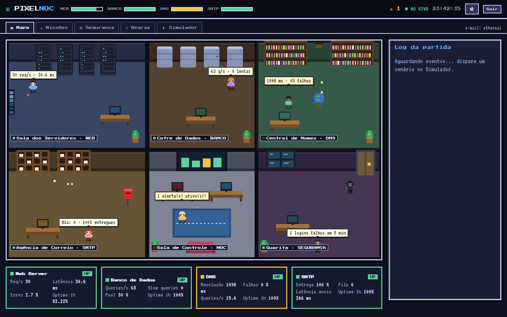

# PixelNOC — Plataforma de Monitoramento para DevOps

Trabalho Final de **Redes de Computadores e Internet** — IDP (Profa. Lorena Borges).

PixelNOC é um painel de monitoramento de serviços de rede (**Web/HTTP, Banco de Dados, DNS e SMTP**) com
visual de jogo em pixel art: cada serviço é uma sala de um data center, com um operador que mostra a
métrica principal num balão de fala e reage ao estado do serviço (verde, amarelo ou vermelho).



## O que tem

| Requisito do trabalho | Onde está |
|---|---|
| Front-end responsivo com dashboards por serviço e visão consolidada | `web/` — mapa (visão consolidada) + painel por serviço com gráficos |
| Backend de ingestão e armazenamento de métricas | `server/` — coletores a cada 5 s, `POST /api/ingest`, SQLite |
| Regras de alerta e notificação por e-mail | `server/src/alerts/` — 3 níveis, e-mail imediato (crítico) e resumo (atenção) |
| Segurança e monitoramentos extras | DDoS (z-score), força bruta, integridade de configuração, CVEs via OSV.dev |
| Documentação | `docs/` — arquitetura, instalação, runbooks, playbooks, testes, roteiro |
| Testes de navegação e uso | `tests/` (Playwright) + `server/test/` (Vitest) |

## Rodar rápido

```bash
npm install
npm run dev
```

Abra http://localhost:5173 — usuário `admin`, senha `redes2026` (troque em `server/.env`).

Detalhes em [docs/instalacao.md](docs/instalacao.md).

## Documentação

- [Arquitetura](docs/arquitetura.md)
- [Guia de instalação](docs/instalacao.md)
- [Runbooks por serviço](docs/runbooks.md)
- [Playbooks de incidentes](docs/playbooks.md)
- [Testes](docs/testes.md)
- [Roteiro da apresentação](docs/apresentacao.md)
- Relatório ABNT: `relatorio/`
