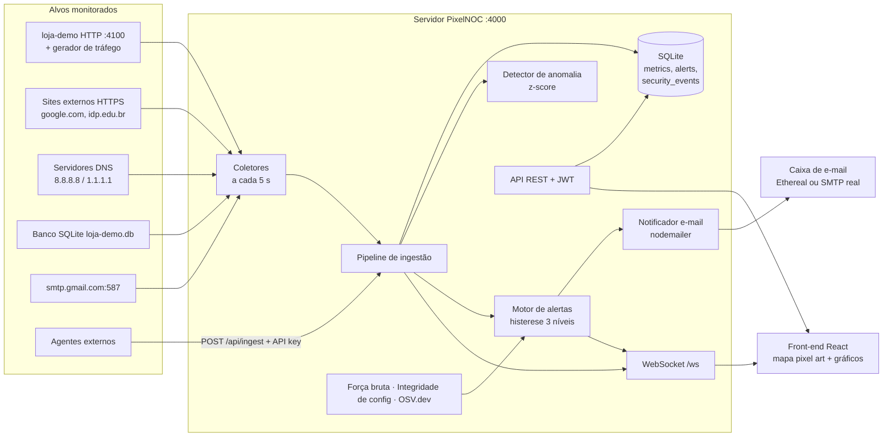

# Arquitetura

## Visão geral



## Componentes

| Componente | Tecnologia | Arquivo |
|---|---|---|
| Servidor HTTP + API REST | Node.js 22+, Express, helmet, rate-limit | `server/src/index.js`, `server/src/routes/api.js` |
| Tempo real | WebSocket (`ws`) autenticado por JWT | `server/src/index.js` |
| Armazenamento | SQLite embutido (`node:sqlite`), retenção de 24 h | `server/src/db.js` |
| Coletores | `fetch`, `dns.Resolver`, `net.Socket`, `node:sqlite`, `os` | `server/src/collectors/*` |
| Alertas | Regras JSON + máquina de estados com histerese | `server/src/alerts/*` |
| E-mail | nodemailer (SMTP real ou conta de teste Ethereal) | `server/src/alerts/notifier.js` |
| Segurança | z-score, janela deslizante, SHA-256, API OSV.dev | `server/src/security/*` |
| Simulador | Cenários de falha/ataque para a demonstração | `server/src/demo/*` |
| Front-end | React 18, Vite, TypeScript, Recharts, Canvas 2D | `web/src/*` |

## Coleta por serviço (camadas de rede)

| Serviço | Protocolo / porta | O que é medido de verdade | O que é simulado |
|---|---|---|---|
| Web | HTTP/1.1 sobre TCP 4100 (local) e HTTPS 443 (externo) | status HTTP, latência, códigos 4xx/5xx, RPS, conexões TCP abertas (`server.getConnections`) | o tráfego dos "clientes" é gerado por um script local |
| Banco | SQL embutido | QPS, latência de query, rollbacks, slow queries (> 50 ms), tamanho em páginas | nº de conexões do pool, latência de disco |
| DNS | UDP 53 | tempo de resolução de registros A em 8.8.8.8 e 1.1.1.1, falhas, QPS | — (cenário de falha usa um IP que não responde, 192.0.2.53) |
| SMTP | TCP 587 | handshake real: banner `220`, `EHLO`, extensões ESMTP, `QUIT` | fila, taxa de entrega e volume do MTA de demonstração |

## Modelo de dados

```sql
metrics(ts, service, metric, value)          -- série temporal (formato "long")
alerts(id, rule_id, service, metric, level, message, value,
       started_at, updated_at, resolved_at, acknowledged, email_preview)
security_events(id, ts, type, severity, source, details)
config_snapshots(file, hash, content, ts)    -- linha de base de integridade
```

## Motor de alertas

- Cada regra (`server/src/alerts/rules.json`) tem métrica, operador (`>` ou `<`), limite amarelo, limite vermelho e `for` (nº de amostras seguidas).
- **Nível 1 — Verde**: nenhuma regra violada.
- **Nível 2 — Amarelo**: limite amarelo violado por `for` amostras → e-mail de resumo (agrupado a cada 60 s).
- **Nível 3 — Vermelho**: limite vermelho violado (ou serviço DOWN) → **e-mail imediato**; ao resolver, outro e-mail "RESOLVIDO".
- Para voltar ao verde são exigidas 2 amostras normais (evita "flapping").
- Alertas de evento (mudança de configuração) ficam abertos até alguém reconhecer.

## API

| Método | Rota | Descrição |
|---|---|---|
| POST | `/api/auth/login` | Login, devolve JWT (monitorado contra força bruta) |
| POST | `/api/ingest` | Ingestão por agentes externos (`x-api-key`) |
| GET | `/api/overview` | Status, últimos valores, uptime, alertas ativos |
| GET | `/api/services/:id/series?range=15m\|1h\|6h\|24h` | Série temporal agregada |
| GET | `/api/alerts`, POST `/api/alerts/:id/ack` | Alertas e reconhecimento |
| GET/PUT | `/api/rules` | Ler/alterar limiares |
| GET | `/api/security`, POST `/api/security/vulns/scan` | Segurança |
| GET/POST/DELETE | `/api/sim/:cenario` | Simulador |
| WS | `/ws?token=` | Eventos `metrics`, `alert`, `status`, `security`, `scenario` |

Exemplo de agente externo:

```bash
curl -X POST http://localhost:4000/api/ingest -H "content-type: application/json" -H "x-api-key: chave-de-ingestao-demo" -d "{\"service\":\"web\",\"metrics\":{\"up\":1,\"rps\":42,\"latency_ms\":35}}"
```
