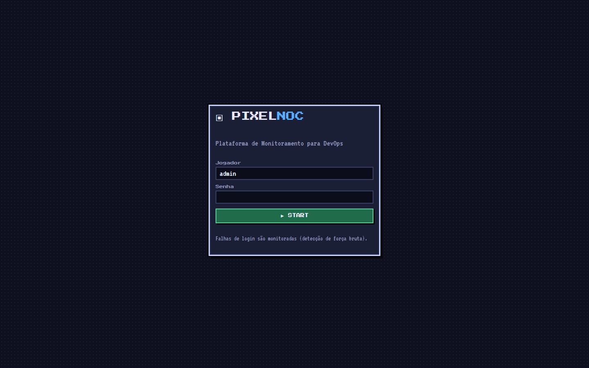
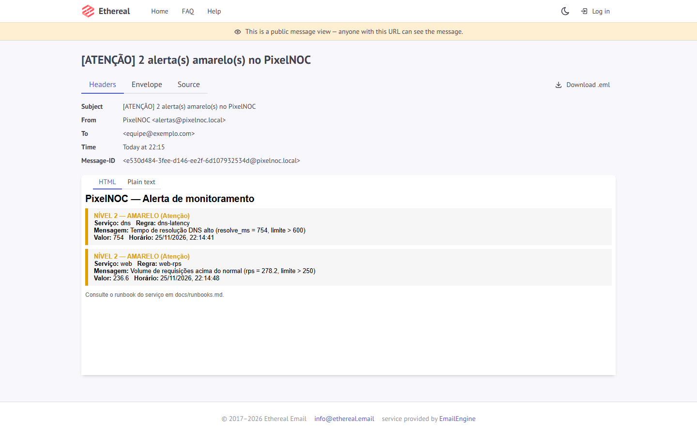

# Guia de instalação

## Requisitos

- **Node.js 22.13 ou superior** (usa o módulo nativo `node:sqlite`; testado no Node 24)
- npm 10+
- Acesso à internet (para os checks reais de HTTPS, DNS, SMTP e a consulta de vulnerabilidades). Sem internet a plataforma roda, mas esses serviços aparecem como DOWN.

## Passo a passo

```bash
git clone https://github.com/dandansph/monitoramento-devops.git monitoramento-devops
cd monitoramento-devops
npm install
```

Opcional — configurar variáveis (senha, alvos, e-mail):

```bash
cp .env.example server/.env
```

Rodar em modo desenvolvimento (API em :4000 e front em :5173):

```bash
npm run dev
```

Acesse http://localhost:5173 e entre com `admin` / `redes2026` (ou o que estiver no `.env`).


*Tela de login exibida ao acessar uma página protegida sem autenticação*


*Tela de login após encerrar a sessão com o botão Sair*


Rodar em modo produção (o servidor entrega o front compilado em :4000):

```bash
npm start
```

## E-mail de alertas

- **Sem configurar nada**: o servidor cria uma conta de teste no **Ethereal** (nodemailer). Os e-mails não chegam a ninguém de verdade, mas cada alerta mostra o link "ver e-mail enviado" com a mensagem renderizada — ideal para a apresentação.


*E-mail de alerta recebido, aberto pelo link ver e-mail enviado*

- **E-mail real (Gmail)**: gere uma "senha de app" na conta Google e preencha em `server/.env`:

```
SMTP_HOST=smtp.gmail.com
SMTP_PORT=587
SMTP_USER=sua.conta@gmail.com
SMTP_PASS=senha-de-app
ALERT_EMAIL_TO=destinatario@exemplo.com
```

## Testes

```bash
npm test
```

```bash
npx playwright install chromium
```

```bash
npm run test:e2e
```

## Portas usadas

| Porta | Uso |
|---|---|
| 4000 | API REST + WebSocket (+ front em produção) |
| 4100 | Servidor web de demonstração "loja-demo" (só 127.0.0.1) |
| 5173 | Front-end em desenvolvimento (Vite) |

## Problemas comuns

| Sintoma | Causa provável / solução |
|---|---|
| `No such built-in module: node:sqlite` | Node antigo — atualize para 22.13+ |
| Todos os serviços externos DOWN | Sem internet ou firewall bloqueando 53/UDP, 443 ou 587 |
| E-mail "modo log" | Não conseguiu falar com o Ethereal/SMTP; veja o console do servidor |
| Porta 4000 em uso | `PORT=4001` no `server/.env` e ajuste o proxy em `web/vite.config.ts` |
