# Testes

## 1. Testes unitários (Vitest) — `npm test`

| Arquivo | O que verifica |
|---|---|
| `server/test/alerts.test.js` | classificação verde/amarelo/vermelho para limites superiores e inferiores; histerese (pico isolado não dispara; N amostras disparam; recuperação exige 2 amostras); status agregado = pior nível |
| `server/test/security.test.js` | detector de anomalia (aprende linha de base, detecta pico, ataque longo não contamina a média); força bruta (bloqueio após 5 falhas, janela deslizante, conta visada por vários IPs); diff de configuração |

Resultado: **14 testes passando**.

## 2. Testes de navegação e uso (Playwright) — `npm run test:e2e`

Executados em dois perfis: **desktop** (1440×900, Chrome) e **mobile** (Pixel 7) para validar o layout responsivo.

| ID | Caso de teste | Passos | Resultado esperado | Desktop | Mobile |
|---|---|---|---|---|---|
| CT01 | Rota protegida | abrir `/alertas` sem login | redireciona para `/login` | ✅ | ✅ |
| CT02 | Login inválido | usuário/senha errados | mensagem de erro; falha registrada na Guarita | ✅ | ✅ |
| CT03 | Visão consolidada | login | 6 salas, 4 cartões de serviço, indicador "AO VIVO" | ✅ | ✅ |
| CT04 | Dashboard por serviço | clicar em cada cartão | painel abre com gráficos; ESC fecha | ✅ | ✅ |
| CT05 | Navegação | percorrer as 5 abas | cada página carrega seu título | ✅ | ✅ |
| CT06 | Alerta crítico | Simulador → "Derrubar o Web Server" | missão CRÍTICO "indisponível" aparece em até 30 s | ✅ | — |
| CT07 | Editar regra | alterar limiar e salvar | mensagem "Regras salvas" | ✅ | — |

Resultado: **12 passaram, 2 pulados por desenho** (CT06 e CT07 rodam só no desktop para não repetir o cenário).
As capturas de tela geradas ficam em `docs/img/`.

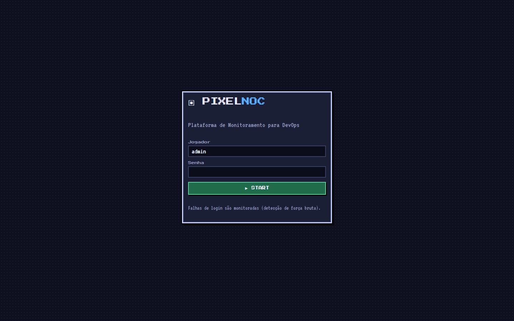
*Tela de login exibida ao acessar uma página protegida sem autenticação*

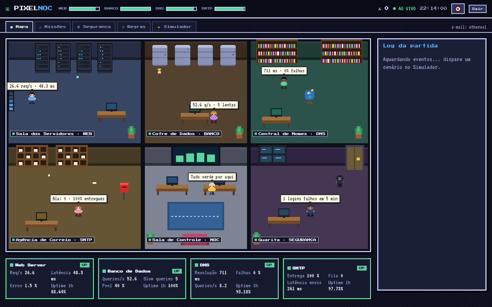
*Mapa com a visão consolidada dos serviços*

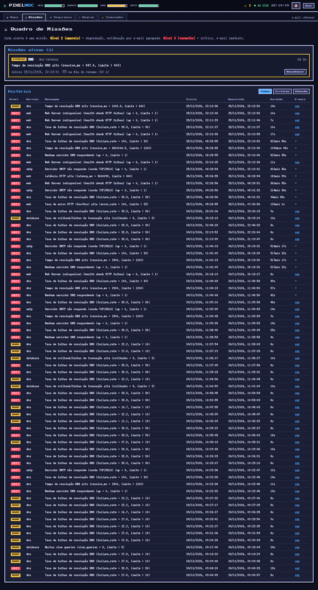
*Quadro de Missões sem alertas ativos*

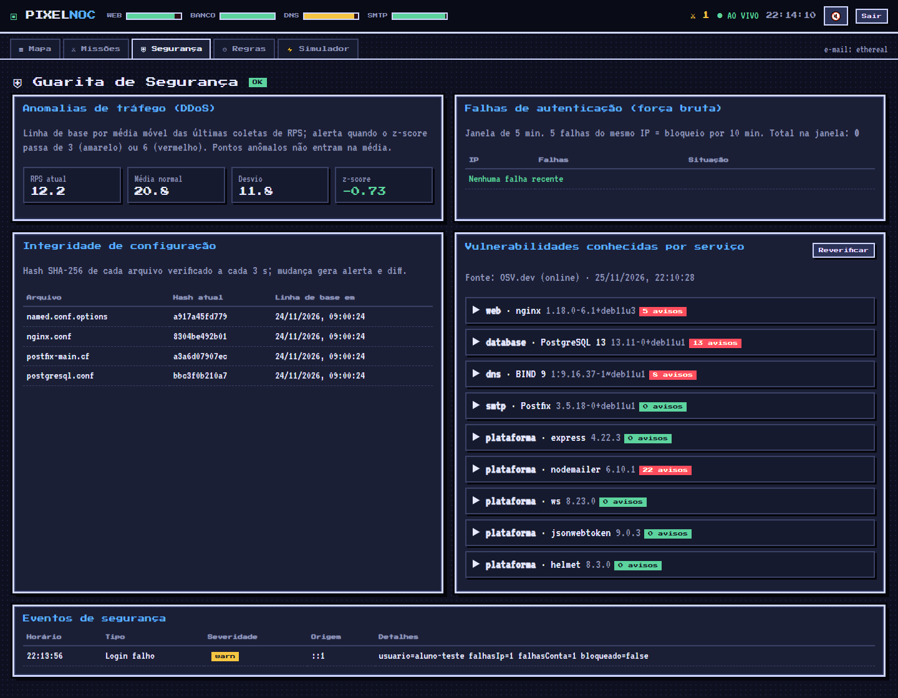
*Guarita de Segurança com eventos, IPs bloqueados e vulnerabilidades conhecidas*

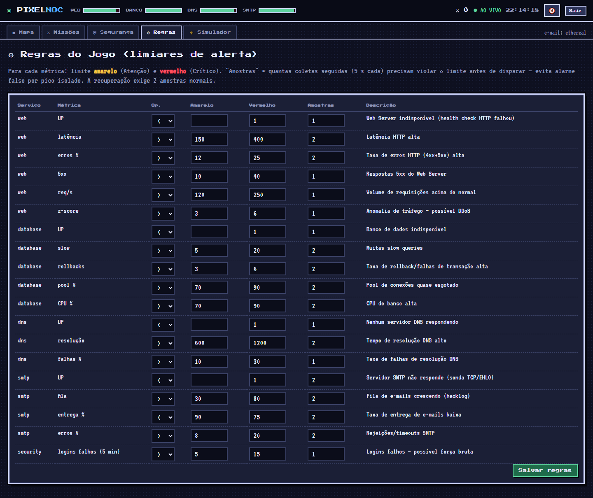
*Tela de Regras com os limiares de alerta editáveis*

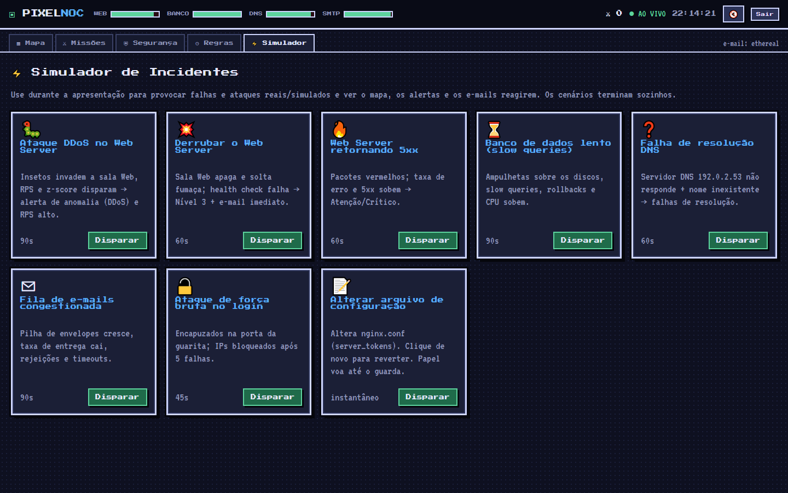
*Simulador de incidentes com os cenários disponíveis*

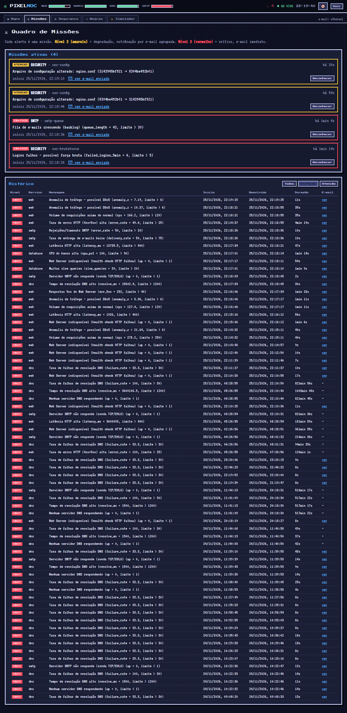
*Histórico de Missões filtrado por alertas críticos*

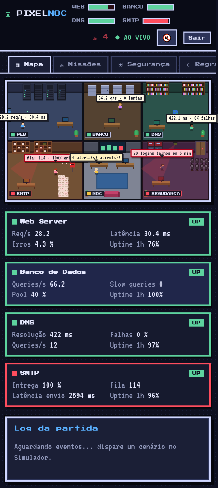
*Mapa em tela de celular*

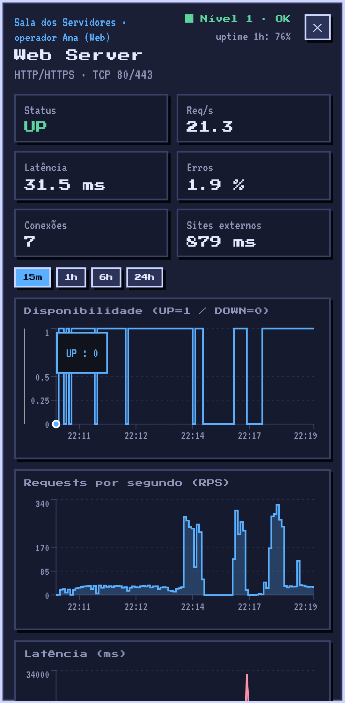
*Painel do Web Server em tela de celular*

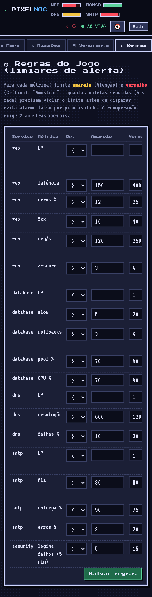
*Tela de Regras em celular*

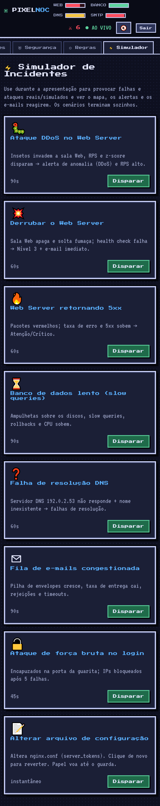
*Simulador de incidentes em celular*

*Tela de login após encerrar a sessão com o botão Sair*

## 3. Testes manuais de cenário (usar na apresentação)

| Cenário | Como disparar | Esperado | Verificado |
|---|---|---|---|
| DDoS | Simulador → Ataque DDoS | RPS ~400, z-score > 6, alerta `web-ddos` e `web-rps` vermelhos, insetos no mapa, e-mail imediato | ✅ |
| Web fora | Simulador → Derrubar Web | sala apagada com fumaça, `web-down` vermelho, e-mail CRÍTICO e depois RESOLVIDO | ✅ |
| Banco lento | Simulador → Banco lento | ampulhetas, `db-slow` e `db-rollback` | ✅ |
| DNS falha | Simulador → Falha DNS | servidor 192.0.2.53 com timeout, `dns-fail` | ✅ |
| Fila SMTP | Simulador → Fila de e-mails | pilha de envelopes, `smtp-queue`, `smtp-delivery` | ✅ |
| Força bruta | Simulador → Força bruta | 6 IPs bloqueados, `sec-bruteforce` vermelho | ✅ |
| Config | Simulador → Alterar configuração | evento com diff `server_tokens`, alerta `sec-config` | ✅ |
| E-mail | qualquer alerta vermelho | link "ver e-mail enviado" abre a mensagem no Ethereal | ✅ |

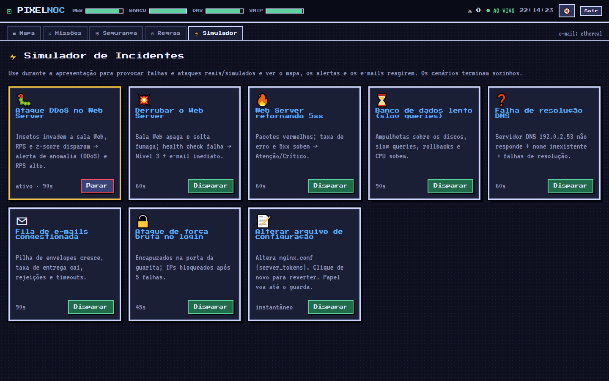
*Disparo do cenário de ataque DDoS no Simulador*

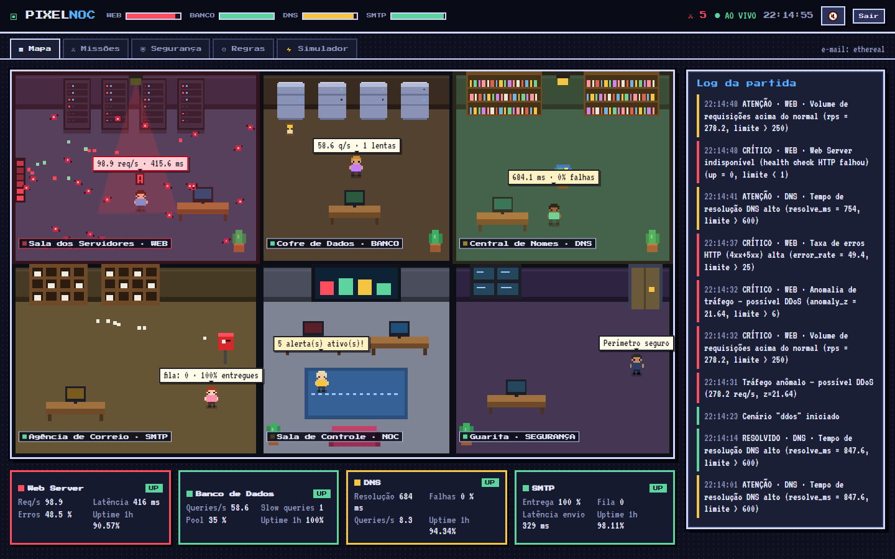
*Mapa durante o ataque DDoS com a sala Web em alerta*

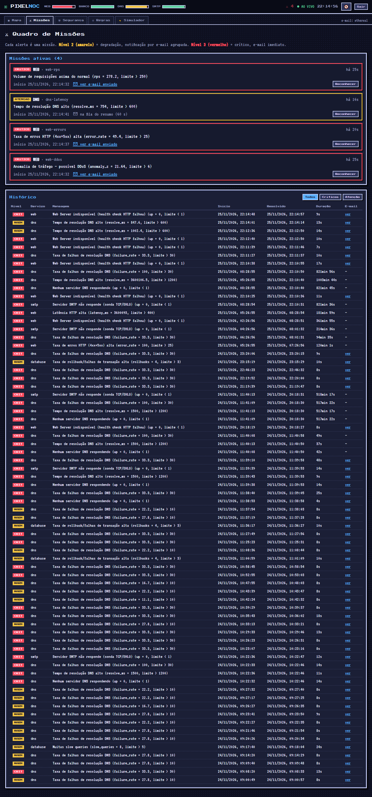
*Missões abertas pelo ataque DDoS*

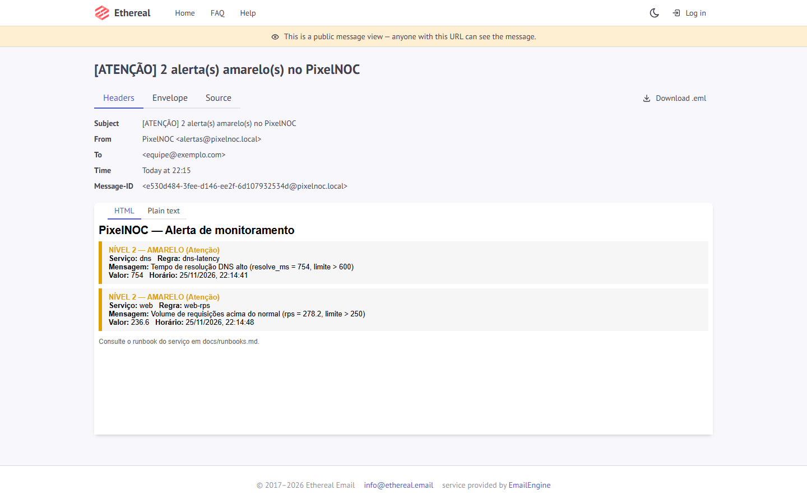
*E-mail de alerta recebido, aberto pelo link ver e-mail enviado*

## 4. Observação encontrada durante os testes

Durante o DDoS o gerador abria uma conexão TCP nova por requisição e esgotou as portas efêmeras do Windows
(`EADDRINUSE` ao enviar e-mail). Corrigido usando keep-alive no gerador do ataque — bom exemplo prático de
como um ataque volumétrico afeta a própria pilha TCP do host.
